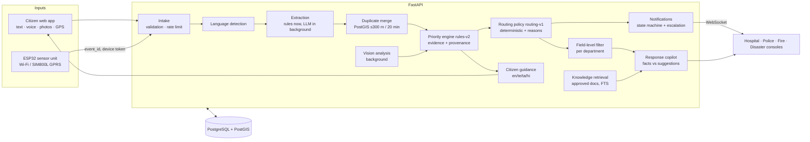

# Architecture

## Principles enforced in code

- **One canonical incident.** IoT alerts and citizen reports for the same event (same compatible category, ≤300 m, ≤20 min, still open) merge into one record; merged reports keep their own text and tracking token and point to the canonical incident (`merged_into_id`). Evidence from all linked reports is combined on every re-assessment.
- **Nothing waits for AI.** Intake commits a rule-based assessment synchronously. LLM extraction and vision run as background tasks, then trigger re-assessment and a push to control rooms.
- **AI never decides operations.** LLM/vision outputs are validated and only feed facts (category, counts, hazards). Priority, routing, notifications, coordinates, distances, routes and availability come from deterministic code or external providers.
- **One record, two languages.** Citizen guidance (their language) and control-room briefs (English) are both rendered from the same stored assessment.
- **Honest failure.** No LLM → rule-based; no vision → image stored, `NOT_ANALYZED`/`PROCESSING_FAILED`; no routing → `available:false` with straight-line distance labelled; DB failure → error, never a fake success.

## Backend services (`backend/app/services`)

| Service | Responsibility |
|---|---|
| `incident_service.py` | Canonical pipeline: intake, merge, assessment orchestration, views, background enrichment |
| `iot_service.py` | Device ingestion, idempotency, qualification rules |
| `language_service.py` | Script/romanised language detection, multilingual keyword tables |
| `ai_service.py` | Extraction (rules + LLM with validation) |
| `llm_provider.py` | Ollama / Gemini / OpenAI-compatible text, vision, speech |
| `vision_service.py` | Upload validation, EXIF stripping, blur/duplicate checks, vision analysis + privacy filter |
| `priority_service.py` | Versioned, explainable 0–100 priority |
| `department_routing_service.py` | Routing policy and per-department field filtering |
| `notification_service.py` | Notification state machine, delivery receipts, escalation |
| `response_copilot_service.py` | English responder briefs (facts / suggestions / uncertainties) |
| `rag_service.py` | Knowledge ingestion and retrieval |
| `resource_service.py` | PostGIS nearby facilities, ranking |
| `routing_service.py` | Amazon Location → OSRM → explicit "unavailable" |
| `taxonomy.py` | Categories and citizen safety-guidance library |
| `audit_service.py`, `realtime.py` | Audit log; WebSocket fan-out |

## Frontend (`frontend/src`)

React 18 + TypeScript + Tailwind + react-router + i18next + react-leaflet. Public pages (landing, report, track) are translated; control-room and admin consoles are English-only by design. Served by FastAPI from `frontend/dist` in production (single origin).

## Scaling notes

The WebSocket manager, rate limiter and escalation loop are in-process. For more than one API worker, move them to Redis (pub/sub, counters) and run the escalation sweep as a single scheduled job.
