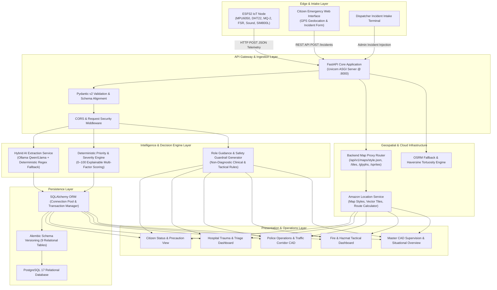
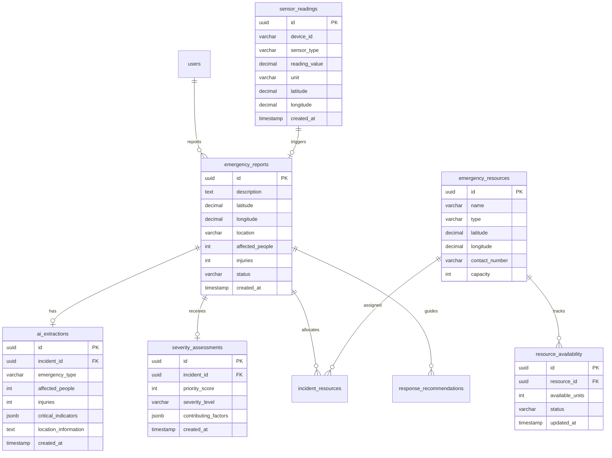

# RESQ.AI — System Architecture & Engineering Design

**RESQ.AI** is a multi-tier, geospatial emergency intelligence and decision-support platform. It integrates IoT edge telemetry and citizen emergency reports, derives structured situational awareness through hybrid AI and deterministic scoring, computes real-time GIS routing via Amazon Location Service, and presents role-specific tactical dashboards for emergency services.

---

## 1. System Topology & Architectural Layers

---

## 2. Component Architecture & Responsibilities

### 2.1 Edge & IoT Layer (`emergency-intelligence-response-main/iot/`)
- **Hardware Architecture**: Built around the **ESP32 DevKit V1** (ESP32-D0WD-V3, 240 MHz dual-core, 520 KB SRAM).
- **Sensor Suite**:
  - **MPU-6050 (I2C 0x68)**: 3-axis accelerometer and gyroscope for high-impact vehicular crash detection (> 5.0 G).
  - **DHT22 (GPIO 4)**: Temperature and relative humidity for thermal runaway and flashover detection (> 60 °C).
  - **MQ-2 (GPIO 32, ADC1)**: Combustible gas, smoke, and LPG detection (> 1500 PPM threshold).
  - **FSR (GPIO 34, ADC1)**: Force-sensitive resistor detecting structural collapse or heavy debris impact.
  - **Sound Sensor (GPIO 35, ADC1)**: Acoustic threshold monitoring for acoustic shockwaves and blast signatures.
  - **SIM800L (UART2: GPIO 16 RX, GPIO 17 TX)**: Cellular modem fallback transport.
- **Fail-Safe Offline Storage**: In-flight telemetry events are buffered in non-volatile flash storage (`Preferences` / NVS) up to 8 events using a priority eviction algorithm that preserves critical emergencies over routine heartbeats.

### 2.2 Ingestion & API Layer (`emergency-intelligence-response-main/backend/app/api/`)
- **FastAPI Framework**: High-performance asynchronous REST API running under ASGI.
- **Dual Endpoint Compatibility**: Provides canonical `/api/v1/...` routes alongside legacy compatibility routes (`/api/...` and root level aliases) to guarantee frontend interoperability.
- **Strict Pydantic Validation**: Sanitizes geographic bounds, ensures non-negative casualties, and normalizes field name variations (e.g., `location` vs. `location_name`).

### 2.3 Hybrid Decision Support & Natural Language Layer (`app/services/ai_service.py`)
- **Primary LLM Runtime**: Calls local **Ollama** API running transformer models (such as `qwen3:4b` or `llama3:instruct`).
- **Bounded Latency & Circuit Breaking**: If the LLM response exceeds 3.0 seconds, connection drops, or invalid JSON is produced, execution instantly falls back to a deterministic regex/keyword parser.
- **Strict Operational Guardrails**:
  - Medical guidance is strictly non-diagnostic bystander triage assistance.
  - AI is strictly prohibited from altering priority numbers or fabricating geographical coordinates.

### 2.4 Priority & Severity Engine (`app/services/priority_service.py`)
- **Explainable Scoring Engine**: Computes a transparent, auditable score from 0 to 100 based on weighted operational criteria:
  $$\text{Priority Score} = \min\left(100, \text{Base}(25) + \sum \text{Modifiers}\right)$$
- **Scoring Modifiers**:
  - Unconscious casualty / severe life threat: $+35$
  - Active fire, trapped occupants, or dense smoke: $+30$
  - Major arterial collision: $+20$
  - Injuries: $+5$ per injured individual (capped at $+30$)
  - Total affected individuals: $+3$ per person (capped at $+15$)
  - Hazardous environment (gas cylinders, fuel spill): $+10$
- **Severity Classification Tiers**:
  - `CRITICAL`: 75 – 100
  - `HIGH`: 50 – 74
  - `MODERATE`: 25 – 49
  - `LOW`: 0 – 24

### 2.5 Geospatial & Amazon Location Service Layer (`app/services/location_service.py` & `routing_service.py`)
- **Amazon Location Service Integration**:
  - **Route Calculator (`geo:CalculateRoute`)**: Computes real-world road network geometry, driving travel durations, and turn-by-turn coordinate arrays.
  - **Map Asset Proxy**: Proxies MapLibre style descriptors (`/api/v1/maps/style.json`), vector tiles (`/tiles/{z}/{x}/{y}`), font glyphs (`/glyphs/...`), and sprites (`/sprites/...`) using backend IAM credentials, bypassing client-side key restrictions.
- **Multi-Tier Routing Fallback Hierarchy**:
  1. **Primary**: Amazon Location Service Routes (`AWS_LOCATION_ROUTE_CALCULATOR`).
  2. **Secondary**: Public OSRM Road Routing API (`router.project-osrm.org`).
  3. **Tertiary**: Local Haversine + Urban Tortuosity Model ($1.30 \times$ Euclidean distance at 40 km/h).

### 2.6 Multi-Factor Resource Discovery & Ranking (`app/services/resource_service.py`)
- Emergency facilities (hospitals, fire stations, police stations, ambulances) are discovered within an operational radius and ranked according to:
  $$\text{Total Score} = 0.40 \times S_{\text{proximity}} + 0.30 \times S_{\text{capacity}} + 0.30 \times S_{\text{match}}$$
  - **Proximity Score ($S_{\text{proximity}}$)**: Decreases linearly with road distance.
  - **Capacity Score ($S_{\text{capacity}}$)**: Ratio of available beds/units to total capacity.
  - **Match Score ($S_{\text{match}}$)**: Compatibility with emergency category (trauma hospital for accident, hazmat unit for chemical fire).

---

## 3. Relational Database Architecture

The persistence layer is managed in **PostgreSQL 17** via **SQLAlchemy** and version-controlled using **Alembic** migrations:

---

## 4. Security, Isolation & Safety Controls

1. **Role-Based Operational Views**: Strict decoupling between the citizen reporting view, hospital receiving bay, police traffic control, and master CAD supervision.
2. **Credential Isolation**: All AWS IAM keys and database credentials reside strictly within environment variables on the backend server. No API keys are distributed to client browsers.
3. **Auditable Incident Ledger**: Every priority score, contributing factor, AI extraction, and responder acknowledgement is recorded with precise timestamps.
4. **Deterministic Failover Guarantee**: In no circumstance does an outage of Ollama, AWS Location, or public internet prevent the system from intaking emergencies or generating initial triage guidance.
