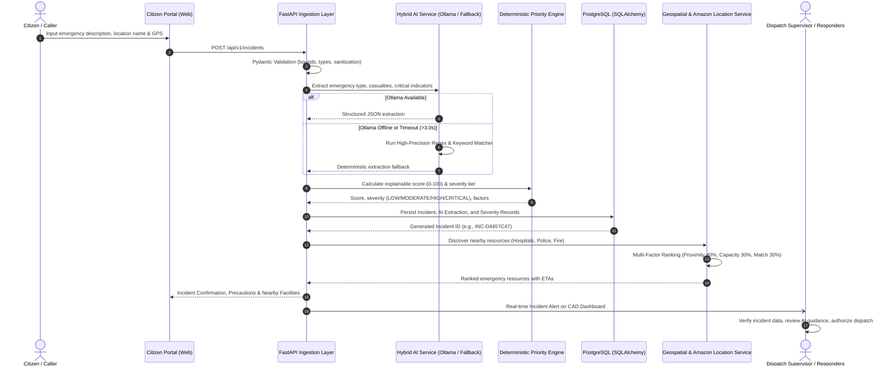
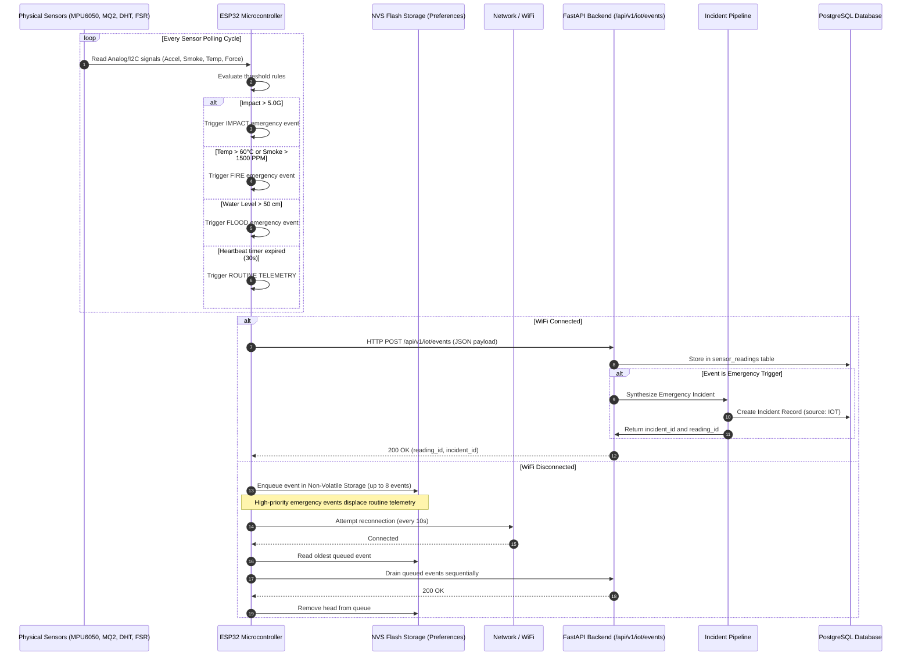
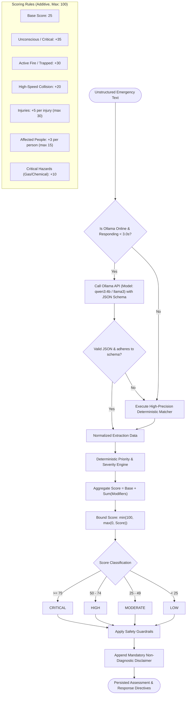
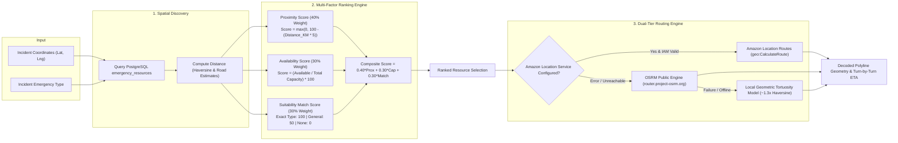
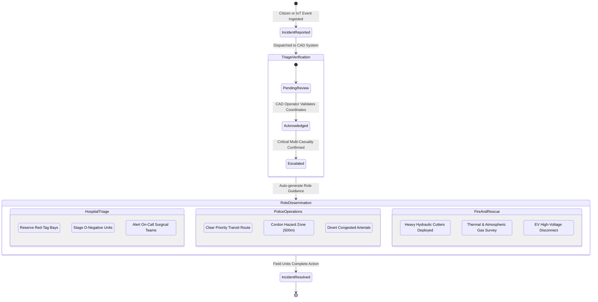

# RESQ.AI — Operational & Technical Workflows

This document details the end-to-end operational, technical, and failure-handling workflows powering the **RESQ.AI** Emergency Intelligence & Decision-Support System.

---

## Table of Contents

1. [Workflow 1: Citizen Emergency Reporting & Multi-Agency Dispatch](#workflow-1-citizen-emergency-reporting--multi-agency-dispatch)
2. [Workflow 2: IoT Sensor Telemetry & Threshold Emergency Ingestion](#workflow-2-iot-sensor-telemetry--threshold-emergency-ingestion)
3. [Workflow 3: Hybrid AI Extraction, Priority Scoring & Safety Guardrails](#workflow-3-hybrid-ai-extraction-priority-scoring--safety-guardrails)
4. [Workflow 4: Geospatial Resource Discovery, Multi-Factor Ranking & Routing](#workflow-4-geospatial-resource-discovery-multi-factor-ranking--routing)
5. [Workflow 5: Role-Specific Tactical Response & Human Verification](#workflow-5-role-specific-tactical-response--human-verification)
6. [Workflow 6: Edge-to-Cloud Fault-Tolerance & Fallback Degradation](#workflow-6-edge-to-cloud-fault-tolerance--fallback-degradation)

---

## Workflow 1: Citizen Emergency Reporting & Multi-Agency Dispatch

### Detailed Execution Steps:
1. **Intake & Validation**: The citizen submits free-text details or pre-fills location via browser geolocation (`navigator.geolocation`). Pydantic ensures latitude [-90, 90], longitude [-180, 180], non-negative casualty counts, and sanitizes input strings.
2. **AI Extraction**: The system constructs an extraction prompt with a strict JSON output schema. If Ollama times out or errors, the deterministic fallback engine extracts numbers, casualty mentions, and hazard terms without failing the request.
3. **Scoring**: `PriorityService` calculates a deterministic score using additive rule weights (base 25, unconscious +35, trapped/fire +30, vehicle collision +20, casualty multipliers).
4. **Persistence**: The incident is committed to `emergency_reports`, `ai_extractions`, and `severity_assessments` in a PostgreSQL transaction.
5. **Geospatial Processing**: Nearest resources are fetched and ranked based on Euclidean/road distance, live available capacity, and suitability.
6. **CAD Broadcast**: All operational roles (Hospital, Police, Fire, Admin) view the incoming incident categorized with its severity badge.

---

## Workflow 2: IoT Sensor Telemetry & Threshold Emergency Ingestion

### Edge Processing Specifics:
- **Impact Sampling Rate**: Accelerometer polled at 100 Hz (10 ms intervals); requires 2 consecutive samples exceeding 5.0 G to filter out transient vibrations.
- **Fire & Smoke**: MQ-2 gas sensor and DHT22 temperature sensor are evaluated simultaneously to detect flaming and smoldering fires.
- **Offline Resilience**: If the field gateway loses connection to the base station, events persist across reboots in ESP32 NVS flash storage. When connectivity is restored, the queue drains automatically in FIFO order.

---

## Workflow 3: Hybrid AI Extraction, Priority Scoring & Safety Guardrails

### Safety Principles & Guardrails:
1. **Decision Support Only**: Language models **never** decide final dispatch actions or assign emergency priority directly.
2. **Deterministic Priority**: The 0–100 score is derived strictly through auditable mathematical rules with explicit factor logging.
3. **Non-Diagnostic Constraint**: Medical advice is restricted to standard bystander first-aid staging and trauma center triage alerts.

---

## Workflow 4: Geospatial Resource Discovery, Multi-Factor Ranking & Routing

### Routing Hierarchy:
- **Primary**: **Amazon Location Service Routes** (`geo:CalculateRoute`) providing real-world road network computation, road class restrictions, and high-accuracy vector geometries.
- **Secondary Fallback**: **OSRM Road Routing API** providing open-source road network calculations.
- **Tertiary Fallback**: **Deterministic Haversine + Urban Tortuosity Model** (1.30x distance multiplier @ 40 km/h emergency speed) guaranteeing that zero network or third-party outages will crash the dispatch pipeline.

---

## Workflow 5: Role-Specific Tactical Response & Human Verification

---

## Workflow 6: Edge-to-Cloud Fault-Tolerance & Fallback Degradation

| Failure Mode | Primary Path | Fallback Path | Impact on Response Operations |
|---|---|---|---|
| **Ollama Service Down** | Local LLM extraction via HTTP port 11434 | Regex and keyword pattern extraction | **Zero downtime**; extraction falls back to 100% deterministic parsing in < 2ms. |
| **Amazon Location Unavailable** | `geo:CalculateRoute` via AWS IAM | OSRM road API → Local Haversine + 1.3x road tortuosity | **Zero disruption**; dispatchers still receive accurate turn-by-turn route approximations. |
| **PostgreSQL Database Offline** | SQLAlchemy session pool | In-memory cache / Static mock resource bank | System surfaces cached resource markers with operational warnings. |
| **Cellular / WiFi Network Loss** | ESP32 direct HTTP transmission | Non-Volatile Flash FIFO Queue (NVS storage) | Sensor events safely buffered on edge hardware; drained automatically upon reconnection. |
| **Malformed Telemetry / Noise** | Raw ADC readings | Multi-sample confirmation + threshold bounds check | Eliminates transient sensor glitches and false alarms. |
